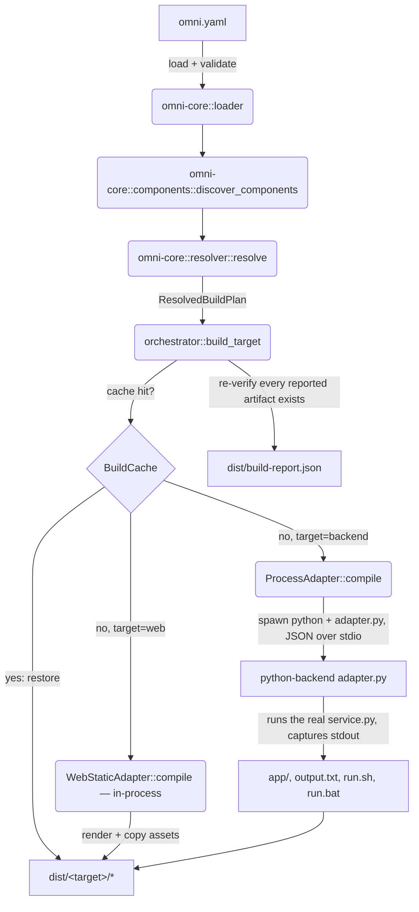

# Architecture

## Layers

**Specification layer** (`specs/*.schema.json`) — versioned JSON Schemas for
every document OmniForge reads: the project file (`omni.yaml`), component
manifests (`component.yaml`), adapter manifests (`adapter.yaml`), the
web-static adapter's app manifest, build reports, and the API contract
format (`api-contract.json`, a small custom OmniForge format inspired by
but not compatible with OpenAPI — see
[docs/api-contract-format.md](api-contract-format.md) and
[ADR 0008](decisions/0008-api-contract-is-a-custom-format.md)). Every document
carries an explicit `schema:` field; an unrecognized value is rejected with
a clear error rather than silently coerced. See
[docs/project-format.md](project-format.md) and
[docs/component-specification.md](component-specification.md).

**Core engine** (`crates/omni-core`) — loads and validates `omni.yaml`
against its schema plus semantic rules (unknown target names, enabled
targets missing an adapter, unsafe paths), discovers and validates component
manifests, resolves which implementation serves which target through the
dependency graph, detects cycles, and provides a content-addressed local
build cache. **This crate never parses JavaScript, Python, Dart, Rust, or
COBOL source** — it only understands OmniForge's own specification
documents. Language- and toolchain-specific work belongs in an adapter.

**Adapter interface and execution engine** (`crates/omni-adapter-api`) —
the `Adapter` trait every adapter implements (`manifest`, `validate`,
`compile`, and a default `dev_serve_plan` for adapters that support a
real dev server — see below); the versioned request/response wire types
for out-of-process adapters (`docs/adapter-protocol.md`); the `process`
module that spawns, feeds, times out, and reads a structured response
from a one-shot adapter call (`ProcessAdapter`, `execute`,
`resolve_executable`); the `devserver` module that spawns and *supervises*
a long-lived dev-server process instead (`ManagedProcess::spawn`/`stop`,
used by `omni dev` — see
[ADR 0009](decisions/0009-unified-dev-process-lifecycle.md)); and a small
conformance checker any adapter's own test suite can call. This is the
one piece of machinery every out-of-process adapter — not just
`python-backend` — reuses; it has no Python-specific knowledge in it.

**Adapters** — connect the core to a real toolchain:
- `crates/omni-web-adapter` (`web-static`) runs **in-process**: it renders
  `{{field}}` templates directly as Rust code, no external toolchain, no
  subprocess.
- `adapters/python-backend/adapter.py` (`python-backend`) runs
  **out-of-process**: a separate Python interpreter, spawned per build,
  speaking the wire protocol. Its manifest and script are embedded into
  the `omni` binary at compile time (`crates/omni-cli/src/adapters/
  python_backend.rs`) and materialized to `.omniforge/adapters/
  python-backend/adapter.py` on first use — so the binary is still
  self-contained, but the adapter itself genuinely runs as a separate OS
  process with its own Python interpreter.

**Build orchestrator** (`crates/omni-cli/src/orchestrator.rs`) — the part
that actually ties a loaded project, discovered components, and the
adapter registry together into one target's build: resolve → (validate |
compile) → cache → verify artifacts → report. It calls `.validate()`/
`.compile()` on a `Box<dyn Adapter>` without knowing or caring whether
that's `WebStaticAdapter` (in-process) or `ProcessAdapter`
(out-of-process) underneath — the whole point of the trait. It is
intentionally sequential; `omni-core::graph::DependencyGraph` already
produces a deterministic order that a future scheduler could run in
parallel across independent targets, but no such scheduler exists yet
(see [docs/roadmap.md](roadmap.md)) — nothing claims parallel execution
today.

**Unified dev runtime** (`crates/omni-cli/src/devrun.rs`) — `omni dev`'s
orchestration: builds every requested/enabled target through the same
`orchestrator::build_target` every other command uses, then starts each
successfully-built one serving (a managed child process via `devserver`,
or the CLI's own static file server for an in-process adapter), and
blocks for a shutdown signal before stopping everything. See
[docs/dev-workflow.md](dev-workflow.md).

## Data flow for `omni build web` vs `omni build backend`

## The full-stack example: `web` + `backend` in one project

`examples/hello-fullstack` enables both `web` and `backend` targets in one
`omni.yaml` — nothing new was needed in `omni-core` or the orchestrator for
this; a project file enabling multiple targets, and `omni build all`
building each independently, already worked exactly as shown above. The
`backend` target's component script (`svc.api/service.py`) is dual-mode:
its default invocation (what `omni build backend` runs) is the same
one-shot contract every other `python-backend` component uses; a
`--serve <port>` convention of that one script starts a real HTTP server
instead. `omni dev` now starts that server itself (via `adapter.yaml`'s
`dev` capability — see
[decisions/0009-unified-dev-process-lifecycle.md](decisions/0009-unified-dev-process-lifecycle.md),
which supersedes [ADR 0007](decisions/0007-backend-dev-server-is-example-scoped.md)'s
original "manual step" framing), and the `web` target's static output
includes a small real `fetch()`-based client (`public/api-client.js`,
shipped through the existing, unmodified `public.js` asset mechanism)
that calls it from a real browser — exercised by a real headless-Chromium
suite (`integration-tests/browser/`), not only by eyeballing it.
`examples/hello-fullstack/backend/api-contract.json`
(`docs/api-contract-format.md`) declares that backend's HTTP surface once;
`crates/omni-cli/tests/fullstack_http.rs` builds the real backend, starts
it as a real subprocess, and checks real HTTP responses against that same
document — the same "declare it once, check reality against it" pattern
the rest of this project already uses for build artifacts (ADR 0005). The
`backend` target also declares `contract:` in `omni.yaml`, so that
document is now schema-validated as part of the build itself and feeds
the build's cache key (see [docs/caching.md](caching.md)), not only
checked by that test.

## Why these trade-offs

A short rationale for decisions that depart from the "obvious" design —
full write-ups in [docs/decisions/](decisions/):

- **Four crates, not twelve.** `omni-core` folds together what the original
  sketch split into `omni-config`/`omni-registry`/`omni-resolver`/
  `omni-contract`/`omni-cache`/`omni-security`/`omni-diagnostics`. The
  module boundaries inside `omni-core` mirror that split (`loader`,
  `components`, `resolver`, `graph`, `cache`, `paths`, `diagnostics`,
  `schema`) so extracting a crate later is a mechanical move, not a
  redesign. See [decisions/0001-crate-count.md](decisions/0001-crate-count.md).
- **In-process adapters first, then one real out-of-process adapter.**
  `web-static` shipped in-process because building a subprocess execution
  engine *and* an honest trust/sandbox story in the same milestone as the
  first working build would have meant a dishonest security claim either
  way. Once the mechanism was built properly — safe argv, enforced
  timeouts, controlled env, protocol validation — `python-backend` became
  the first adapter to use it. See
  [decisions/0002-in-process-adapters.md](decisions/0002-in-process-adapters.md)
  (original rationale) and
  [decisions/0005-out-of-process-python-backend.md](decisions/0005-out-of-process-python-backend.md)
  (what changed and what didn't — third-party adapter trust is still not
  implemented).
- **Template substitution, not a scripting/JS engine, for `web-static`.**
  Embedding a JS engine would make "component" ambiguous between "data"
  and "code" and reopen the exact injection class `security-review` exists
  to catch. A `{{field}}`-only renderer has one job and a two-line
  security argument (escape on substitution, reject undeclared names).
  See [decisions/0003-template-only-rendering.md](decisions/0003-template-only-rendering.md).
- **The CLI gained a `lib` target.** `omni-cli` was bin-only until the
  Python adapter needed white-box tests (forcing a missing-toolchain
  failure deterministically, driving the real adapter script with
  hand-crafted protocol requests) that black-box `assert_cmd` testing
  can't do reliably across platforms. See
  [decisions/0004-cli-lib-split.md](decisions/0004-cli-lib-split.md).
- **A manifest capability, not a new wire-protocol operation, for `omni
  dev`'s process management.** A generic `Run` operation would need an
  answer for every adapter about how a long-lived child hands off and
  what the protocol says about a response that never comes; `adapter.yaml`'s
  `dev` block sidesteps that by describing the adapter's *build output*
  instead. See [decisions/0009-unified-dev-process-lifecycle.md](decisions/0009-unified-dev-process-lifecycle.md).
- **The API contract format stopped claiming OpenAPI 3.1 compatibility.**
  An earlier description of it as "a subset of OpenAPI 3.1" was found to
  be inaccurate — the format isn't a valid OpenAPI document by any real
  OpenAPI tool's reading (no `openapi` field, no `content`/media-type
  wrapping, draft-07 rather than OpenAPI 3.1's 2020-12-based dialect).
  Corrected to describe it as what it actually is: a small, custom,
  OpenAPI-*inspired* format. See
  [decisions/0008-api-contract-is-a-custom-format.md](decisions/0008-api-contract-is-a-custom-format.md).
